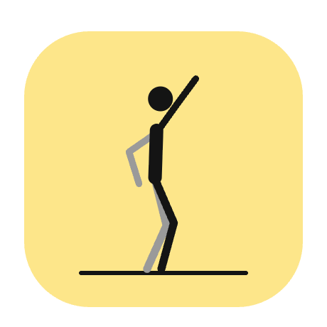

# /stick-scene

Skill to make your agent draw little stick-figure scenes that show what your product does.

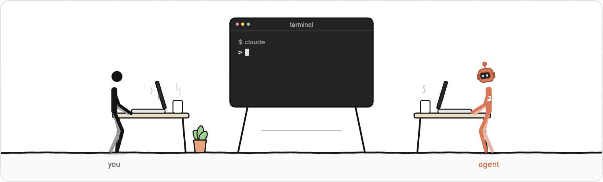

Each scene is one `<canvas>` with no dependencies. It idles quietly, breathing and glancing around, and plays a short action when it scrolls into view, on click or on hover.

## Make a scene

Install the skill

```bash
npx skills add nilbuild/stick-scene
```

Then ask your agent

```bash
/stick-scene [what you want to show]

/stick-scene a scene for the hero of this landing page
/stick-scene show that our CLI turns a YAML file into JSON
/stick-scene one scene for each feature section on the homepage
/stick-scene show an agent fixing the comments I leave on a diff
```

It reads your project, pitches two or three ideas for you to pick from, writes the scene, renders it frame by frame to check that nothing overlaps or gets cut off, and adds it to your page.

## Ask for changes

If something looks off, say what is wrong e.g.

- "the note covers his face", "the bubble runs off the edge"
- "make the robot think for a moment before it starts"
- "slower", "loop it", "only play it on click"
- "use our brand green", "add a second agent in teal"
- "light up the steps on the page as it plays"

## Examples

Every scene below is in [`examples/`](examples).

<table>
  <tr>
    <td width="50%">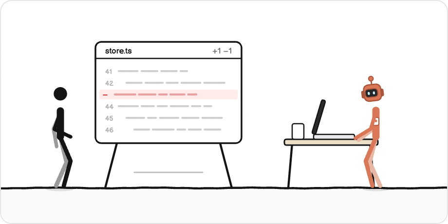<br><b>Review</b>: comment on a line, the agent fixes it, you approve</td>
    <td width="50%">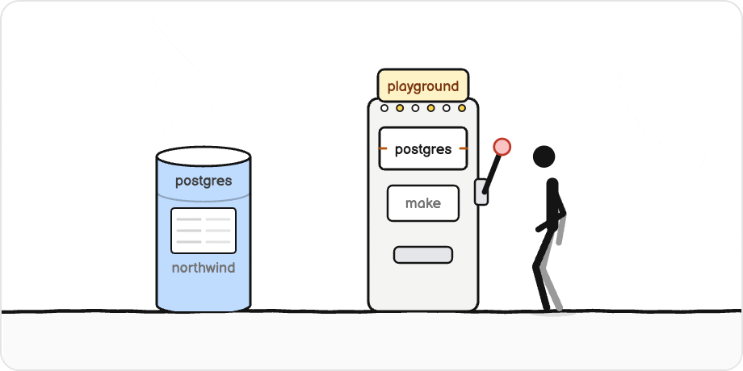<br><b>Database</b>: pull the lever and a database rises</td>
  </tr>
  <tr>
    <td>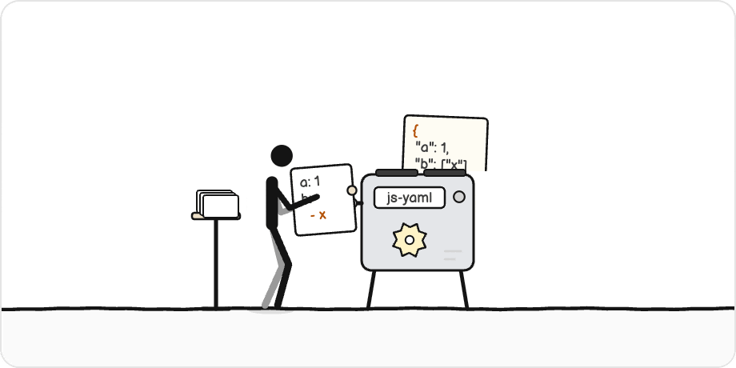<br><b>Converter</b>: feed YAML in, turn the crank, JSON pops out</td>
    <td>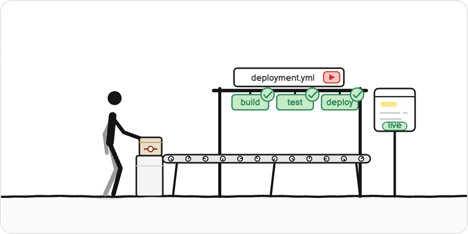<br><b>CI</b>: push a commit down the workflow</td>
  </tr>
  <tr>
    <td>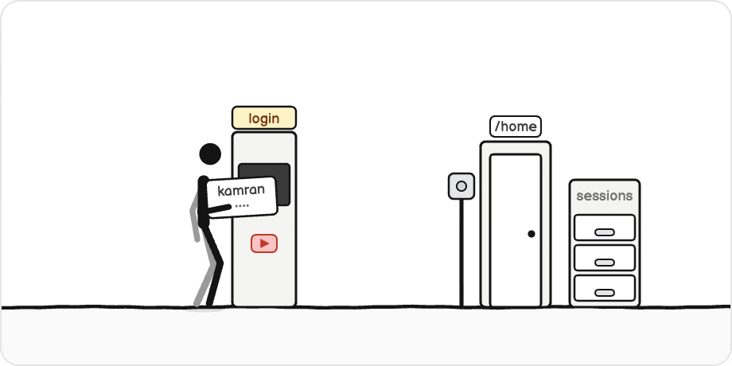<br><b>Login</b>: log in once and a cookie opens the door</td>
    <td>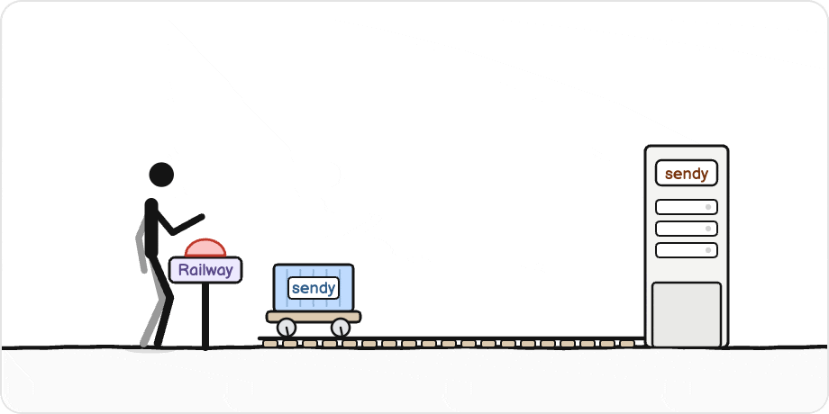<br><b>Email</b>: one click and the letters fly out</td>
  </tr>
  <tr>
    <td>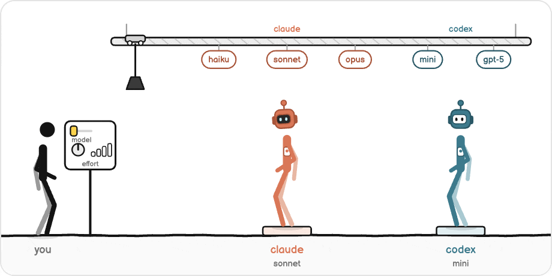<br><b>Models</b>: a spotlight picks the model, a knob sets the effort</td>
    <td>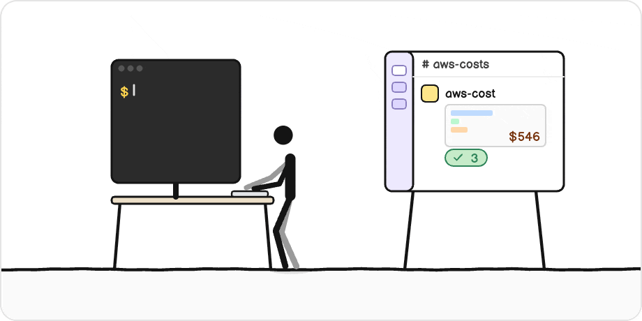<br><b>Reports</b>: the bill prints and goes into Slack</td>
  </tr>
  <tr>
    <td>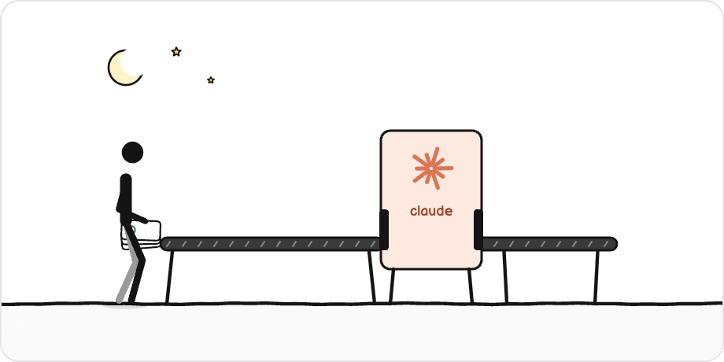<br><b>Queue</b>: issues line up and the agent works through them overnight</td>
    <td>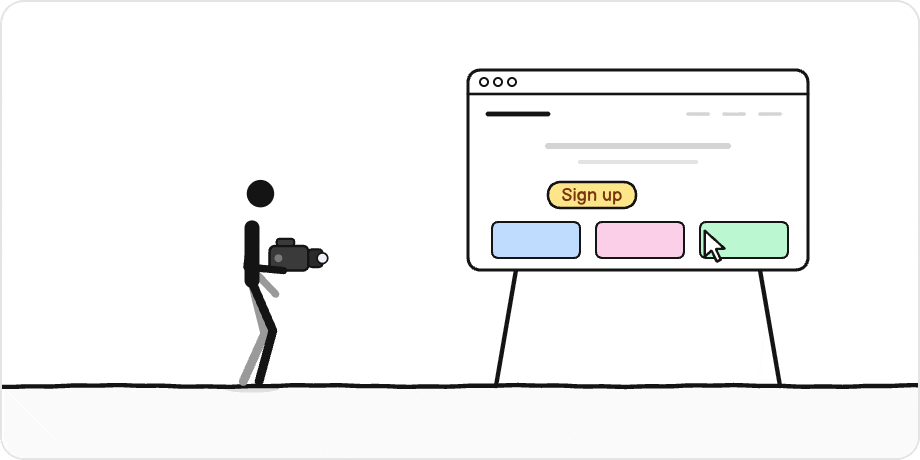<br><b>Recording</b>: the camera operator films the app</td>
  </tr>
  <tr>
    <td>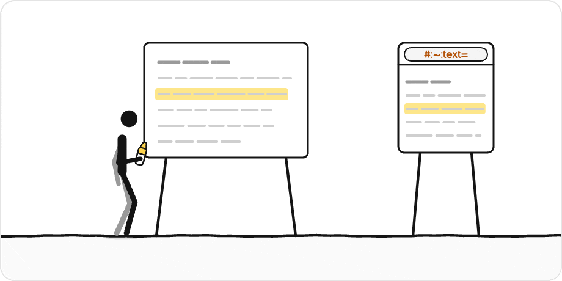<br><b>Highlights</b>: mark a line, copy the link, it opens highlighted</td>
    <td>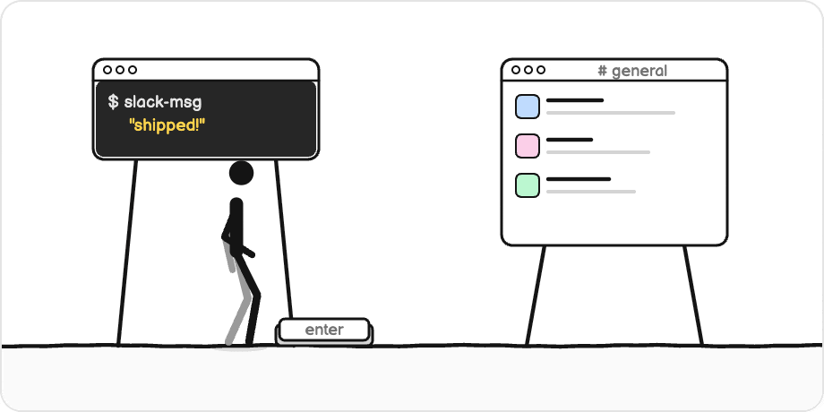<br><b>Messages</b>: stomp on enter and it lands in Slack</td>
  </tr>
</table>

## Use a scene

Copy `runtime/stick.js` and your scene into the site's static folder and add

```html
<stick-scene scene="db-playground" play="view" style="height: 230px"></stick-scene>

<script src="/scenes/stick.js" defer></script>
<script src="/scenes/db-playground.js" defer></script>
```

| Attribute | |
| --- | --- |
| `scene` | the id the scene registers |
| `play` | `view` plays once when it scrolls into view, then on click. Also `click`, `hover`, `loop` and `idle` |
| `no-floor` | drop the grey band under the ground line, for plain white pages |
| `no-ground` | drop the ground line too |
| `zoom` | scale the drawing inside the box, default `1` |
| `label` | what a screen reader hears, defaults to the scene's own sentence |

Size it with CSS. Scenes off screen don't draw, and with reduced motion on, a scene shows one still frame and never plays.

## License

MIT © [Kamran Ahmed](https://kamran.fyi).
